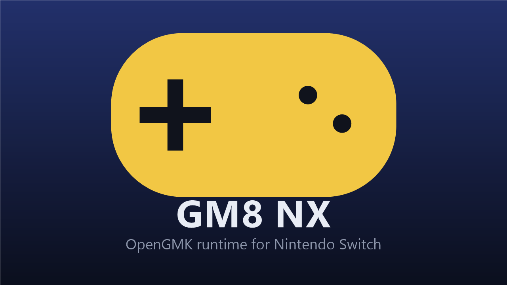
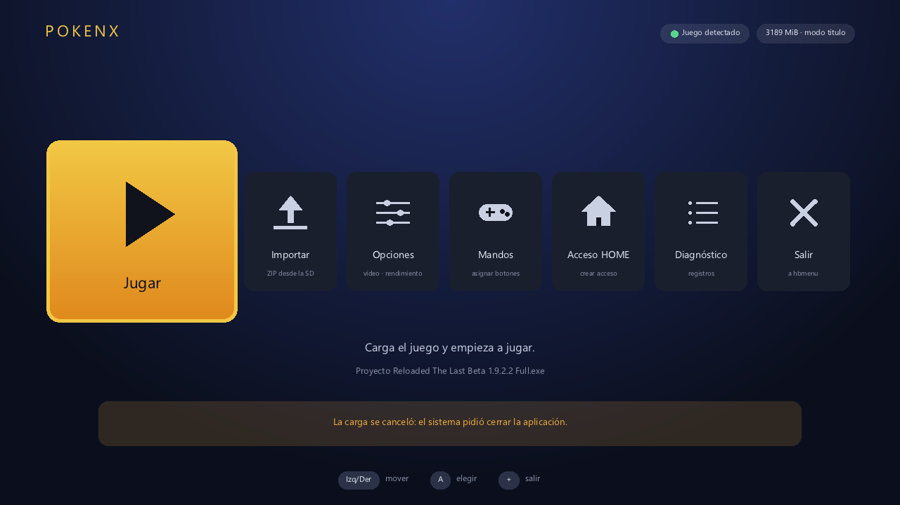
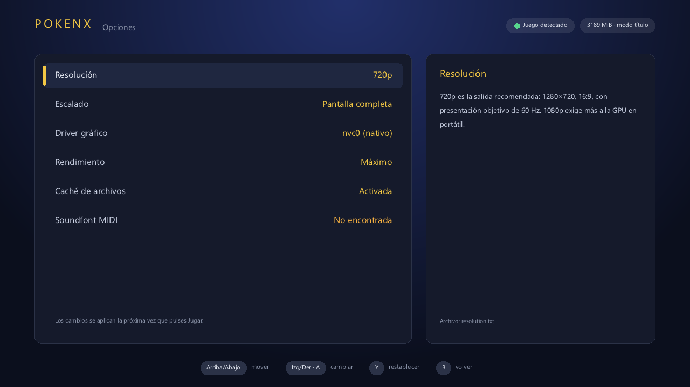
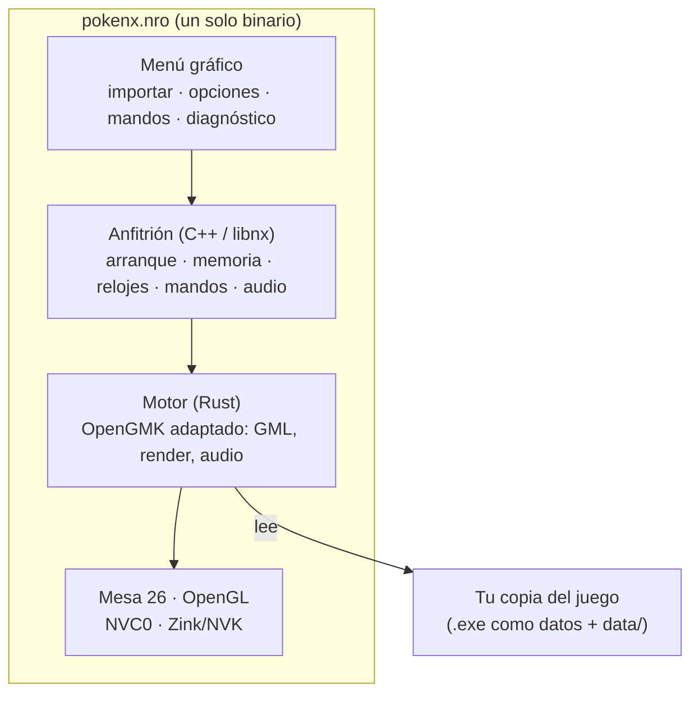

<div align="center">



</div>

# Pokémon Reloaded en Nintendo Switch

Ejecuta **Pokémon Reloaded** en una Nintendo Switch con Atmosphère, **sin emulador de Windows** de por medio. Proyecto abierto, para la comunidad. [English](README.en.md)

> [!IMPORTANT]
> **Este repositorio no incluye el juego ni ningún dato suyo.** Necesitas tu propia copia (el `.exe` y su carpeta `data/`). El proyecto es independiente: **no está afiliado ni respaldado por Nintendo, Game Freak, The Pokémon Company ni por los autores de Pokémon Reloaded.**

> [!NOTE]
> **Un proyecto de afición, hecho con ayuda de IA.** Esto es una prueba y un pasatiempo, no un producto: lo desarrolle yo con la ayuda de [Claude Code](https://claude.com/claude-code) (un asistente de programación IA), escribió buena parte del código y de la documentación bajo mi dirección. el launcher/motor y juego puede tener errores que nadie ha visto, se ha probado en una sola consola y no hay garantías ni soporte asegurado. Los informes y las mejoras son bienvenidos.

## Qué es esto, en realidad

Pokémon Reloaded es un juego hecho con GameMaker 8 para Windows. Aquí **no se ha reescrito ni recompilado nada del juego**: un único programa para la Switch (`pokenx.nro`) lee el `.exe` original **solo como archivo de datos** y ejecuta su código GML con un motor propio, derivado de [OpenGMK](https://github.com/OpenGMK/OpenGMK) (la reimplementación en Rust del motor de GameMaker 8) y del trabajo de [Klisee](https://github.com/Klisee/pokemon-reloaded-android) para Android. **El código x86 del `.exe` no se ejecuta nunca.**

Lo que aporta este proyecto es todo lo que el juego esperaba de Windows y la Switch no tiene: gráficos OpenGL (Mesa), mandos, audio, gestión de memoria, menú, importación del juego y registros. El juego no se toca.

## Estado

Funciona **a medias**. Probado por una persona, en una consola (Atmosphère 1.12.1, firmware 23.0.0), con la versión 1.9.2.2 del juego: abre, renderiza, suena, responde a los mandos y se jugó un rato sin problemas. Sin un informe tuyo, lo demás **no** está verificado:

| Etapa | Estado |
|---|---|
| Compila y pasa las comprobaciones automáticas (PC y compilación cruzada) | ✅ |
| Abre en la consola · renderiza · suena · controles · se juega | ✅ (una consola) |
| Otras versiones del juego · otras consolas y firmwares · 60 FPS siempre · driver Zink/NVK (fuera del menú: aún no presenta fotogramas) · 1080p en dock | ❔ sin verificar |

## Qué necesitas

- Una **Nintendo Switch con [Atmosphère](https://github.com/Atmosphere-NX/Atmosphere)** y [Homebrew Menu](https://github.com/switchbrew/nx-hbmenu).
- **Tu copia del juego**: la última versión se consigue en el [blog de F3R Productions](https://pokemon-reloaded.blogspot.com/), autores del juego (la versión probada es la 1.9.2.2).
- Una microSD con espacio libre para el juego y los datos del programa.
- Para tener toda la memoria, abre el programa **como aplicación** (por ejemplo, abriendo cualquier juego con **R** pulsado, o con un acceso directo en HOME). Desde el Álbum (modo applet) el menú bloquea «Jugar» por poca memoria.

## Cómo se usa

1. Descarga el ZIP de la [última *Release*](../../releases) y extráelo en la **raíz** de la microSD (crea `switch/pokenx/`).
2. Copia tu juego a `switch/pokenx/game/` (el `.exe` y la carpeta `data/`), o usa **Actualizaciones**: descarga la versión del blog oficial o instala un ZIP que ya tengas en la microSD.
3. Abre **PokeNX** desde Homebrew Menu → **Jugar**.

La primera carga analiza unos 20 000 recursos y tarda. Mientras carga se ve una barra, HOME sigue funcionando y **+** cancela.

```text
sdmc:/switch/pokenx/
  ├── pokenx.nro            (el programa)
  ├── game/                 (tu .exe y data/)
  ├── logs/                 (boot.log, engine.log, crash.log, informe.txt…)
  ├── controls.txt  resolution.txt  scaling.txt  graphics-driver.txt  performance.txt  filecache.txt  stickzone.txt  cacert.pem
  ├── soundfont.sf2         (opcional: música MIDI)
  └── saves/ shader/ cache/
```

## El menú

 

| Mosaico | Qué hace |
|---|---|
| **Jugar** | Carga el juego |
| **Actualizaciones** | Busca versiones nuevas en el blog oficial del juego, las descarga e instala **sin tocar tus partidas**, instala un ZIP de la microSD (validando rutas, CRC y estructura antes de sustituir nada) y gestiona copias de seguridad de partidas y ajustes |
| **Opciones** | Resolución (720p/1080p), escalado, rendimiento, caché de archivos, zona muerta del palo, precarga del juego y **medidor de FPS** |
| **Mandos** | Qué tecla produce cada botón, dos **capas** de teclas (ZL: F1–F12 y páginas; ZR: cifras y letras de menús), tres **perfiles** (Por defecto, Perfil 1, Perfil 2) y una **vista** del mando con las teclas asignadas |
| **Teclas** | Las teclas que usa el juego y qué botón produce cada una |
| **Acceso HOME** | Crea (o quita) un icono en la pantalla de inicio desde el propio programa; también se puede generar el NSP en el PC (`scripts/build-nsp.ps1`) |
| **Diagnóstico** | Memoria, modo, tiempos de carga, registros y un informe exportable |

## Controles

| Botón de la Switch | Tecla del juego (por defecto) |
|---|---|
| A / B / X / Y | Z / X / C / V |
| L / R | M / B |
| ZL / ZR | S / O |
| + / − | Espacio / Intro |
| Clic de palo izq. / der. | E / Esc |
| Cruz y palo izquierdo | Flechas |

Todo se reasigna en **Mandos**. **Salir del juego: L + R + +.** Sin controles táctiles en pantalla.

El juego usa teclas que ningún botón da solo (F1–F12, Supr, Ins, Inicio, Fin, Re Pág, Av Pág). Para eso hay una **capa**: mantén **ZL** y pulsa otro botón (por ejemplo ZL + A = F5, ZL + B = F6, ZL + cruz = F1, F9, Re Pág, Av Pág); un toque corto de ZL sigue enviando su tecla de siempre. Hay tres perfiles de mandos (**ZL/ZR** cambian de uno a otro): *Por defecto*, *Perfil 1* y *Perfil 2*; la pestaña **Vista** dibuja el mando con la tecla de cada botón. Una segunda capa con **ZR** da las cifras 1–6 y letras de menús (ZR + A = 1, ZR + cruz = Q, P, L, F…). La pantalla **Teclas** muestra las teclas que usa el juego (las tuyas, si las cambiaste jugando), qué botón produce cada una y cuáles no tienen botón.

## Rendimiento y relojes

**Medidor de FPS:** **Opciones → Medidor de FPS** muestra en una esquina los fotogramas por segundo y el hueco más largo entre dos fotogramas. **Precarga:** al abrir el menú se analizan los datos del juego en segundo plano y **Jugar** se ahorra ese tiempo.

El programa sube los relojes de la consola mientras juegas y los devuelve al salir (**Opciones → Rendimiento**):

| Perfil | CPU | GPU portátil | GPU en dock |
|---|---|---|---|
| Máximo (por defecto) | 1785 MHz | 460,8 MHz | 768 MHz |
| Equilibrado | 1224 MHz | 384 MHz | 614,4 MHz |
| Sin cambios | los del sistema | los del sistema | los del sistema |

## Cómo funciona



Los detalles están en tres documentos: [qué cambiamos del motor](docs/MOTOR.md), [Mesa, NVK y OpenGL](docs/GRAFICOS.md) y [mandos, audio, menú, archivos y detección](docs/SISTEMA.md).

## Versiones del juego

Se detecta **por contenido** cualquier `.exe` de GameMaker 8.0 estándar, no por nombre. Detectarlo no garantiza que funcione (funciones de GameMaker sin implementar, DLL, otros formatos): ver [docs/SISTEMA.md](docs/SISTEMA.md#detección-y-versiones-del-juego).

## Si algo falla

Copia `switch/pokenx/logs/` (y `atmosphere/crash_reports/` si el programa se cerró). `boot.log` dice hasta dónde arrancó. **Diagnóstico → X** crea `informe.txt`. Mira primero [docs/ERRORES-FRECUENTES.md](docs/ERRORES-FRECUENTES.md); si no está ahí, abre una incidencia con eso, la versión de Atmosphère y firmware, y la versión del juego.

## Compilar

Necesitas Windows, el kit de la Switch (devkitPro), Rust y el SDK de Mesa para la Switch. Todo lo que hay que instalar está en [REQUISITOS.md](REQUISITOS.md) y los pasos en [docs/GUIA.md](docs/GUIA.md) (sirven para hacerlos tú o para dárselos a un asistente de IA; el repositorio incluye [AGENTS.md](AGENTS.md) y [.claude/](.claude)). Si algo falla al compilar: [docs/ERRORES-FRECUENTES.md](docs/ERRORES-FRECUENTES.md).

```powershell
pwsh scripts/doctor.ps1          # comprueba que tienes todo lo necesario (REQUISITOS.md)
pwsh app/build-package.ps1     # compila pokenx.nro y crea la carpeta pokenx/ para la microSD
pwsh scripts/check.ps1         # pruebas que no necesitan consola
```

## Estructura del repositorio

```text
app/engine/        programa de la Switch: menú gráfico, anfitrión (libnx, EGL, audio, mandos), enlace
app/assets/        icono y portada
src/gm8-runtime/   el motor (24 crates)
scripts/           compilación, comprobaciones, Mesa, release
app/forwarder/     el acceso directo de HOME (un cargador que arranca el NRO)
tools/             vista previa del menú y pruebas de la lógica del actualizador
.github/           integración continua y plantillas
docs/              documentación
```

## Qué sigue

Validar en hardware lo nuevo (acceso de HOME creado desde el programa, capa 2, medidor de FPS, precarga) y afinar el rendimiento y el controlador gráfico Zink. Para contribuir, mira [CONTRIBUTING.md](CONTRIBUTING.md).

## Créditos y licencia

GPL-2.0-only ([LICENSE](LICENSE)). Gracias a OpenGMK, a Klisee, a Mesa y a los proyectos de la Switch: [CREDITOS.md](CREDITOS.md). Pokémon es una marca de Nintendo, Game Freak y Creatures; este proyecto no está afiliado ni respaldado por ellos.
